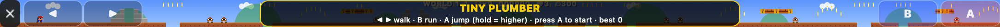

# widefive

Take over the MacBook Pro Touch Bar completely and make it yours: widgets, per-app script layouts,
gestures, Mario-style games, a synth, an audio visualizer, ambient scenes and more. Built from scratch in
Swift for the 2016–2020 Touch Bar MacBook Pros (developed for a 2020 13" i5).

No firmware or T2 hacking: widefive is a normal menu-bar app that uses the private `DFRFoundation`
API (`presentSystemModalTouchBar`) to replace the whole strip, Control Strip included. Quit the app and
your stock Touch Bar comes back.





## Run it

```bash
git clone https://github.com/rayhankhilji/widefive && cd widefive
swift build -c release
.build/release/widefive            # menu-bar app, takes over the Touch Bar
.build/release/widefive --preview  # also opens an on-screen preview strip (mouse = finger)
```

Requires macOS 12+ and Xcode or the Command Line Tools. On first launch macOS will ask for:

| Permission | Why |
| --- | --- |
| Accessibility | sending key chords / typing text from buttons |
| Automation | AppleScript actions, Spotify/Music now-playing fallback |
| Microphone | the visualizer mode (only when you open it) |

Grant them in System Settings → Privacy & Security, then relaunch. The menu-bar icon has
modes, themes, "Edit config", "Reload Touch Bar", "Start at login" and Quit.

### Global hotkeys

| Keys | Action |
| --- | --- |
| ⌃⌥⌘ Space | mode launcher |
| ⌃⌥⌘ H | home |
| ⌃⌥⌘ G | Tiny Plumber |
| ⌃⌥⌘ P | toggle preview window |
| ⌃⌥⌘ T | re-present the Touch Bar (if macOS stole it back) |

## Modes

| id | what |
| --- | --- |
| `home` | per-app buttons in the middle, widgets on the right |
| `launcher` | neon tiles for every mode (tap the leftmost button on home) |
| `plumber` | **Tiny Plumber**: Mario-style side-scroller. ◀ ▶ walk, B run, A jump (hold = higher). ? blocks, mushrooms, stars, bricks, goombas, spikies, flagpole, endless generated worlds |
| `dash` | **Neon Dash**: auto-runner platformer. Tap to jump, tap again to double-jump, stomp bots |
| `flip` | **Gravity Flip**: tap to flip gravity between floor and ceiling |
| `piano` | 2-octave polyphonic synth with multi-touch, 4 waveforms, octave shift |
| `visualizer` | live mic FFT spectrum across the whole strip |
| `ambient` | nyan, matrix rain, starfield, game of life, fire, aurora (tap to cycle) |
| `clipboard` | clipboard history, tap to copy an entry back |
| `dock` | running apps, tap to switch, long-press to hide |
| `stats` | CPU / RAM / network / temp / fan / battery / disk |

The games also take keyboard input when the preview window is focused (arrows, space, shift).

## Gestures (home mode)

- two-finger horizontal slide → volume
- three-finger slide → brightness
- two-finger tap → play/pause
- swipe in from the left edge → launcher
- fast one-finger flick → next/previous mode in `flickOrder`

## Per-app layouts and scripts

Everything lives in `~/.widefive/config.json` (created on first launch, hot-reloaded on save).
Print the full default with `widefive --print-default-config`.

```jsonc
{
  "theme": "neon",                 // neon | mono | sunset | retro | ocean
  "hideControlStrip": true,
  "startMode": "home",
  "apps": [
    {
      "name": "VS Code",
      "bundleIds": ["com.microsoft.VSCode"],
      "items": [
        { "kind": "button", "title": "Palette", "icon": "command", "action": { "keys": "cmd+shift+p" } },
        { "kind": "button", "title": "Test", "icon": "checkmark.seal",
          "action": { "shell": "cd ~/code/app && npm test 2>&1 | tail -1", "showOutput": true } },
        { "kind": "button", "title": "Deploy", "color": "#ff2d95",
          "action": { "applescript": "display notification \"shipping\"" },
          "longPress": { "url": "https://vercel.com/dashboard" } },
        { "kind": "widget", "name": "cpu" }
      ]
    },
    { "name": "Final Cut", "bundleIds": ["com.apple.FinalCut"], "items": [], "passthrough": true }
  ]
}
```

Action fields: `keys`, `shell`, `applescript`, `url`, `open` (app name/bundle id/path), `mode`,
`media` (`playpause|next|previous|volup|voldown|mute|brightup|brightdown`), `type` (+`submit`),
`showOutput`. Item kinds: `button`, `widget`, `slider` (`volume`/`brightness`), `spacer`, `separator`.
`passthrough: true` hands the stock Touch Bar back while that app is frontmost; `mode` opens a mode.

Built-in layouts: VS Code/Cursor/Windsurf, Xcode, Terminal/iTerm/Warp/Ghostty, browsers, Spotify/Music,
Finder, Slack/Discord, Figma, Zoom/Teams, Final Cut/Logic (passthrough).

Widgets: `clock`, `date`, `cpu`, `ram`, `battery`, `network`, `temp`, `fan`, `disk`, `uptime`,
`weather`, `app`, `nowplaying`, `pomodoro`.

## Adding a mode

Modes are small classes implementing `StripMode` (see `Sources/WideFiveKit/Core/Mode.swift`).
You get a `Canvas` the size of the strip (1085×30 points) every frame plus touch and key callbacks:

```swift
public final class HelloMode: StripMode {
    public let id = "hello", title = "Hello", icon = "hand.wave"
    public var isAnimated: Bool { true }
    var t = 0.0
    public func update(dt: Double) { t += dt }
    public func draw(_ c: Canvas) {
        c.fill(c.bounds, .hsb(CGFloat(t * 0.1), 0.8, 0.4))
        c.text("hello touch bar", x: c.width / 2, size: 12, align: .center)
    }
    public func touchBegan(_ t: StripTouch) { /* t.x is 0…1085 */ }
}
```

Register it in `ModeRegistry.standard()` and it shows up in the launcher.

## Development

```bash
swift test
swift run widefive --snapshot plumber shot.png 2   # render any mode headlessly to a PNG
```

## Caveats

- Private APIs: Apple can change them in any macOS update. If the strip stops showing, hit ⌃⌥⌘T or
  open an issue with your macOS version.
- Temperature/fan readings use the Intel SMC and show "—" on Apple Silicon.
- Brightness uses the private DisplayServices framework.
