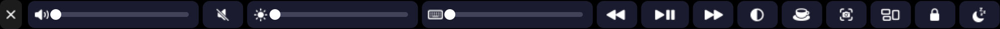

# widefive

Take over the MacBook Pro Touch Bar completely and make it yours: widgets, per-app script layouts,
gestures, Mario-style games, a synth, an audio visualizer, ambient scenes and more. Built from scratch in
Swift for the 2016–2020 Touch Bar MacBook Pros (developed for a 2020 13" i5).

No firmware or T2 hacking: widefive is a normal menu-bar app that uses the private `DFRFoundation`
API (`presentSystemModalTouchBar`) to replace the whole strip, Control Strip included. Quit the app and
your stock Touch Bar comes back.




## Install

> **First launch (important):** widefive isn't notarized by Apple, so macOS blocks the first open.
> **Right-click widefive.app → Open → Open**. On macOS 15+ (or if there's no Open button):
> try to open it once, then **System Settings → Privacy & Security → scroll down → "Open Anyway"**.
> You only do this once; updates keep working afterwards.

| Option | How |
| --- | --- |
| **DMG** (recommended) | Download `widefive-x.y.z.dmg` from [Releases](https://github.com/rayhankhilji/widefive/releases/latest), open it, drag widefive onto Applications |
| **Zip** | Download `widefive-x.y.z.zip`, unzip, move `widefive.app` to `/Applications` |
| **Homebrew** | `brew install --cask rayhankhilji/tap/widefive` |
| **From source** | see below |

If macOS says the app "is damaged" (a quarantine flag on unsigned downloads), run once:
`xattr -dr com.apple.quarantine /Applications/widefive.app`.

widefive runs on macOS 12+ (Apple Silicon and Intel, universal binary). It lives in the menu bar
(no Dock icon); the menu shows the version at the top.

### Permissions

On first use macOS will ask for these; grant them in System Settings → Privacy & Security, then relaunch:

| Permission | Why |
| --- | --- |
| Accessibility | sending key chords / typing text from buttons, locking game keys to the bar |
| Automation | AppleScript actions, Spotify/Music now-playing fallback |
| Microphone | the visualizer mode (only while it's open) |

The menu-bar icon has modes, themes, "Edit config", "Reload Touch Bar", "Launch at Login",
"Check for Updates…" and Quit.

### From source

```bash
git clone https://github.com/rayhankhilji/widefive && cd widefive
swift build -c release
.build/release/widefive            # menu-bar app, takes over the Touch Bar
.build/release/widefive --preview  # also opens an on-screen preview strip (mouse = finger)
Scripts/build-app.sh --native      # or: build your own build/widefive.app
```

Requires Xcode or the Command Line Tools. Auto-update is off when running from source.

## Updating

| Installed via | Update |
| --- | --- |
| DMG / zip | automatic: widefive checks once a day (Sparkle). When an update is found you get a Touch Bar toast and **Install Update x.y.z…** in the menu. Or use **Check for Updates…** any time. Turn background checks off with **Automatically Check for Updates** |
| Homebrew | auto-update works too; or `brew upgrade --cask widefive` |
| Source | `git pull && swift build -c release` |

Updates are verified with an EdDSA signature (Sparkle) before they're installed, so they're safe without
an Apple Developer ID. The feed is `https://github.com/rayhankhilji/widefive/releases/latest/download/appcast.xml`.

## Global hotkeys

| Keys | Action |
| --- | --- |
| ⌃⌥⌘ Space | mode launcher |
| ⌃⌥⌘ H | home |
| ⌃⌥⌘ G | Tiny Plumber |
| ⌃⌥⌘ P | toggle preview window |
| ⌃⌥⌘ T | re-present the Touch Bar (if macOS stole it back) |
| ⌃⌥⌘ K | lock / unlock the keyboard to the current game |
| ⌃⌥⌘ C | control bar |
| ⌃⌥⌘ M | show the menu-bar icon menu (even when hidden) |

## Modes

| id | what |
| --- | --- |
| `home` | per-app buttons in the middle, widgets on the right |
| `launcher` | neon tiles for every mode (tap the leftmost button on home) |
| `plumber` | **Tiny Plumber**: Mario-style side-scroller. ◀ ▶ walk, B run, A jump (hold = higher). ? blocks, mushrooms, stars, bricks, goombas, spikies, flagpole, endless generated worlds |
| `dash` | **Neon Dash**: auto-runner platformer. Tap to jump, tap again to double-jump, stomp bots |
| `flip` | **Gravity Flip**: tap to flip gravity between floor and ceiling |
| `snake` | **Snake** across the whole strip |
| `pong` | **Pong** rotated: your paddle at the bottom, AI at the top, first to 7 |
| `breakout` | **Breakout** with two rows of bricks |
| `flappy` | **Flap**: tap to flap through the gaps |
| `shooter` | **Starstrip**: side-scrolling shooter, pad = up/down, A = fire |
| `race` | **Strip Racer**: pseudo-3D arcade racer. Pick vs bots or vs a friend (split screen), a track (Neon City / Coast / Alpine), then each player picks a car (Lamborghini, F1, Land Rover, G-Wagon, BMW M5, Audi R8, LaFerrari) and a view (chase / cockpit / hood). 3 laps, nitro, AI cars. Sound is off every time you open it; turn it on in the menu |
| `duel` | **Strip Duel**: two-player arena shooter across the whole bar. Blaster / Tank / Ninja, each with a charge-up special. Best of 3 vs a bot or a friend |
| `control` | control bar: volume, mute, display brightness, keyboard backlight, media, dark mode, caffeine, screenshot, Mission Control, lock, display sleep |
| `timer` | stopwatch with laps + 1/3/5/10/25 min countdowns |
| `calc` | calculator with every key visible at once |
| `emoji` | tap to type an emoji, recents float to the front |
| `pet` | pixel cat that speeds up when your CPU is busy, naps when it's idle, tap to pet |
| `piano` | 2-octave polyphonic synth with multi-touch, 4 waveforms, octave shift |
| `visualizer` | live mic FFT spectrum across the whole strip |
| `ambient` | nyan, matrix rain, starfield, game of life, fire, aurora (tap to cycle) |
| `clipboard` | clipboard history, tap to copy an entry back |
| `dock` | running apps, tap to switch, long-press to hide |
| `stats` | CPU / RAM / network / temp / fan / battery / disk |

### Playing games without a window

Every game has a ⌨ button next to the ✕. Tap it (or press ⌃⌥⌘K) to **lock the keyboard to the game**:
arrows / WASD, space, Z, X and Return go to the game instead of your Mac, and the on-bar game buttons
disappear. Tap it again (or press Esc) to give the keys back. ⌘/⌃/⌥ shortcuts are never captured.
**P pauses** any game.

Two-player games: **P1** = WASD, F (shoot / nitro), G (special), S (shield / brake).
**P2** = arrows, / (shoot / nitro), . (special), ↓ (shield / brake). Without the lock, each side of the bar gets its own touch pad. Needs Accessibility permission. Without the lock, the keys also work when the
preview window is focused.

## Gestures (home mode)

- two-finger horizontal slide → volume
- three-finger slide → brightness
- two-finger tap → play/pause
- swipe in from the left edge → launcher
- fast one-finger flick → next/previous mode in `flickOrder` (off by default since it fights scrolling; set `gestures.flickModes`)

## Per-app layouts and scripts

Everything lives in `~/.widefive/config.json` (created on first launch, hot-reloaded on save).
Print the full default with `widefive --print-default-config`.

```jsonc
{
  "theme": "neon",                 // neon | mono | sunset | retro | ocean
  "hideControlStrip": true,
  "startMode": "home",
  "apps": [
    {
      "name": "VS Code",
      "bundleIds": ["com.microsoft.VSCode"],
      "items": [
        { "kind": "button", "title": "Palette", "icon": "command", "action": { "keys": "cmd+shift+p" } },
        { "kind": "button", "title": "Test", "icon": "checkmark.seal",
          "action": { "shell": "cd ~/code/app && npm test 2>&1 | tail -1", "showOutput": true } },
        { "kind": "button", "title": "Deploy", "color": "#ff2d95",
          "action": { "applescript": "display notification \"shipping\"" },
          "longPress": { "url": "https://vercel.com/dashboard" } },
        { "kind": "widget", "name": "cpu" }
      ]
    },
    { "name": "Final Cut", "bundleIds": ["com.apple.FinalCut"], "items": [], "passthrough": true }
  ]
}
```

Action fields: `keys`, `shell`, `applescript`, `url`, `open` (app name/bundle id/path), `mode`,
`media` (`playpause|next|previous|volup|voldown|mute|brightup|brightdown`), `type` (+`submit`),
`showOutput`. Item kinds: `button`, `widget`, `slider` (`volume`/`brightness`), `spacer`, `separator`.
`passthrough: true` hands the stock Touch Bar back while that app is frontmost; `mode` opens a mode.

Built-in layouts: VS Code/Cursor/Windsurf, Xcode, Terminal/iTerm/Warp/Ghostty, browsers, Spotify/Music,
Finder, Slack/Discord, Figma, Zoom/Teams, Final Cut/Logic (passthrough).

Widgets: `clock`, `date`, `cpu`, `ram`, `battery`, `network`, `temp`, `fan`, `disk`, `uptime`,
`weather`, `app`, `nowplaying`, `pomodoro`.

## Adding a mode

Modes are small classes implementing `StripMode` (see `Sources/WideFiveKit/Core/Mode.swift`).
You get a `Canvas` the size of the strip (1085×30 points) every frame plus touch and key callbacks:

```swift
public final class HelloMode: StripMode {
    public let id = "hello", title = "Hello", icon = "hand.wave"
    public var isAnimated: Bool { true }
    var t = 0.0
    public func update(dt: Double) { t += dt }
    public func draw(_ c: Canvas) {
        c.fill(c.bounds, .hsb(CGFloat(t * 0.1), 0.8, 0.4))
        c.text("hello touch bar", x: c.width / 2, size: 12, align: .center)
    }
    public func touchBegan(_ t: StripTouch) { /* t.x is 0…1085 */ }
}
```

Register it in `ModeRegistry.standard()` and it shows up in the launcher.

## Strip size

widefive reads your Mac's model (`hw.model`) and sizes the strip to match: 1004pt on Macs with a
physical Esc key (2019 16", 2020 13"), 1085pt on 2016–2018 models. The detected model and width are
shown at the top of the menu. If it's still off, use **Strip Width → Narrower / Wider** or set
`"stripWidth"` in the config.

## Background mode

widefive has no Dock icon or window. Turn on **Hide Menu-Bar Icon** to remove the menu-bar icon too;
⌃⌥⌘M opens the menu again.

## Development

```bash
swift test
swift run widefive --snapshot plumber shot.png 2   # render any mode headlessly to a PNG
```

## Releasing

Everything is in `Scripts/` and runs on any Mac; the GitHub Actions workflow just calls it.

**One-time setup** (the update signing key):

```bash
Scripts/setup-sparkle-keys.sh   # makes an EdDSA key in your login keychain,
                                # writes Resources/sparkle-public-key.txt, uploads SPARKLE_PRIVATE_KEY via gh
git add Resources/sparkle-public-key.txt && git commit -m "Add Sparkle public key" && git push
```

The private key never goes in the repo. Back it up (`.build/artifacts/sparkle/Sparkle/bin/generate_keys -x key.txt`
→ password manager, then delete the file): if it's lost, installed copies can't verify updates anymore.
If `gh` isn't logged in, add the secret by hand under Settings → Secrets and variables → Actions.

**Each release:**

```bash
echo 0.2.0 > VERSION && git commit -am "v0.2.0"
git tag v0.2.0 && git push origin main v0.2.0   # .github/workflows/release.yml builds + publishes
# or, without Actions:
Scripts/release.sh v0.2.0             # dry run → dist/ (app zip, dmg, appcast.xml, widefive.rb, SHA256SUMS.txt)
Scripts/release.sh v0.2.0 --publish   # same, then creates the GitHub release with gh
```

| Script | Does |
| --- | --- |
| `build-app.sh [--native]` | universal release build → `build/widefive.app` (Info.plist, icon, Sparkle.framework, signed) |
| `make-dmg.sh` | `dist/widefive-x.y.z.dmg` (drag-to-Applications window) + `.zip` |
| `appcast.sh vX.Y.Z` | `dist/appcast.xml`, previous releases kept, EdDSA-signed |
| `notarize.sh <path>` | notarize + staple, skipped without Apple credentials |
| `make-icon.sh` | regenerate `Resources/AppIcon.icns` from `Scripts/art.swift` |

Version = the tag (or `VERSION`); build number = commit count, so it always increases.

**Signing.** By default builds are ad-hoc signed (`codesign -s -`), which needs no Apple account. To ship
signed + notarized builds later, add these Actions secrets: `APPLE_DEVELOPER_ID_CERT` (base64 .p12 of a
Developer ID Application certificate), `APPLE_DEVELOPER_ID_CERT_PASSWORD`, `APPLE_ID`, `APPLE_TEAM_ID`,
`APPLE_APP_PASSWORD` (app-specific password). Locally, a Developer ID in your keychain is picked up
automatically (override with `CODESIGN_IDENTITY`), plus the three `APPLE_*` env vars for notarization.

**Homebrew tap.** Create the repo `rayhankhilji/homebrew-tap` once, then after each release copy
`dist/widefive.rb` (the [Casks/widefive.rb](Casks/widefive.rb) template with the version + sha256 filled in)
to `Casks/widefive.rb` in the tap and push. Users install with `brew install --cask rayhankhilji/tap/widefive`.

## Caveats

- Private APIs: Apple can change them in any macOS update. If the strip stops showing, hit ⌃⌥⌘T or
  open an issue with your macOS version.
- Temperature/fan readings use the Intel SMC and show "—" on Apple Silicon.
- Brightness uses the private DisplayServices framework; keyboard backlight uses private CoreBrightness
  (falls back to the F5/F6 illumination keys).
- The Intel MacBook Pro keyboard backlight is a single zone: one level for every key. Per-key lighting
  isn't possible in software on that hardware.
