<div align="center">

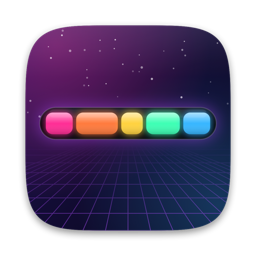

# widefive

**Your Touch Bar, rebuilt from scratch.**<br>
An arcade, a race track, a dashboard and a remote for every app, in the 30-pixel strip above your keyboard.

[](https://github.com/rayhankhilji/widefive/releases/latest)
&nbsp;

&nbsp;


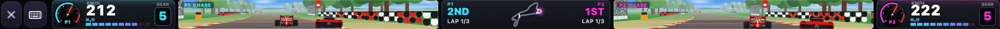

<sub>Two players, one Touch Bar. Speedometers on the edges, the live track map in the middle.</sub>

</div>

---

Apple gave the Touch Bar a few emoji buttons and a volume slider. widefive takes over the whole strip (the Control Strip too) and draws whatever it wants at 60 fps: 11 games, live widgets, buttons that change with the app you're in, gestures, a synth and 10 themes.

It's a normal menu-bar app. No firmware hacks and no T2 jailbreak. Quit it and your stock Touch Bar comes straight back.

## Get it

1. **[Download the latest DMG](https://github.com/rayhankhilji/widefive/releases/latest)** and drag widefive into Applications.
2. Open it the first time with **right-click → Open → Open**. widefive isn't notarized by Apple, so macOS asks once. On macOS 15+, try opening it once, then go to **System Settings → Privacy & Security → Open Anyway**.
3. Allow **Accessibility** when it asks. Buttons need it to send shortcuts, and games need it to borrow your keyboard.

That's it. widefive checks for updates daily and installs them in one click.

<details>
<summary>Zip, from source, and the "app is damaged" message</summary>

- **Zip:** grab `widefive-x.y.z.zip` from [Releases](https://github.com/rayhankhilji/widefive/releases/latest), unzip, move `widefive.app` to `/Applications`.
- **From source:**
  ```bash
  git clone https://github.com/rayhankhilji/widefive && cd widefive
  swift build -c release && .build/release/widefive
  ```
  Add `--preview` for an on-screen strip you can click with the mouse (handy on Macs without a Touch Bar). The first release build takes a few minutes; later builds are quick.
- **"widefive is damaged and can't be opened":** that's the quarantine flag on unsigned downloads. Run `xattr -dr com.apple.quarantine /Applications/widefive.app` once.
- **Permissions:** Accessibility (shortcuts, typing, game key lock, Dock badges and raising windows for the agent strip), Automation (AppleScript buttons, now playing, finding agent tabs in browsers and terminals), Microphone (only while the visualizer is open).

</details>

## Games

Every game runs on the bar itself. Tap **⌨** (or press <kbd>⌃⌥⌘K</kbd>) and your keyboard becomes the controller. Press it again, or <kbd>Esc</kbd>, to give the keys back. <kbd>P</kbd> pauses.

### Strip Racer: 1 or 2 players


Race five bots or a friend on four circuits: a **Grand Prix** track with grandstands, crowds, kerbs and a start gantry, plus **Coast**, **Alpine** and **Night City**. Pick from seven cars, each with its own top speed, acceleration and grip: Lamborghini Aventador, F1, Land Rover Defender, Mercedes G 63, BMW M5, Audi R8 and LaFerrari. The off-roaders barely slow down on grass; the F1 car really does. Choose a camera per player: chase, hood or cockpit.

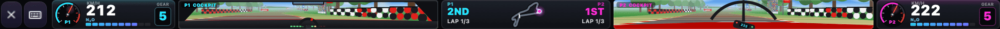

Three laps, nitro, start lights and a podium. Sound starts off every time, so it never surprises you in a library.

### Strip Duel: 2 players


A fighting game the full width of the bar. **Blaster** sprays a five-way shot, **Tank** has 150 HP and a ground-pound quake, **Ninja** triple-jumps and dashes. Specials charge as you land and take hits. Best of three, against a bot or the person next to you.

### Tiny Plumber

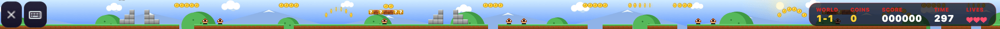

The Mario-style one: ? blocks, mushrooms, stars, breakable bricks, enemies to stomp and a flagpole, with a fresh world generated every level.

### The arcade

| | |
|:--|:--|
| 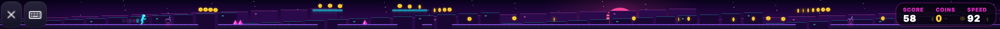<br>**Neon Dash.** It runs on its own; you tap to jump and double-jump. | 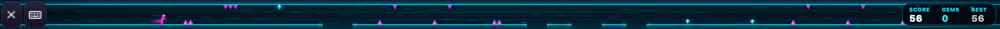<br>**Gravity Flip.** One button flips you between floor and ceiling. |
| 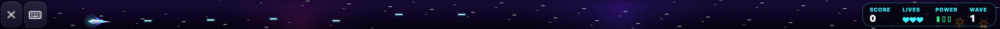<br>**Starstrip.** A side-scrolling shooter with power-ups and waves. | 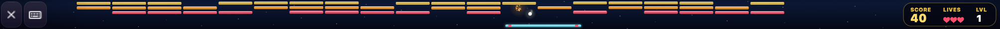<br>**Breakout.** Bricks across 1004 points of glass. |
| 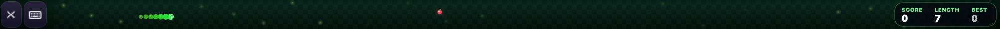<br>**Snake.** The longest snake you'll ever play. | <br>**Pong** and **Flap** round it out. |

**Two-player keys:** P1 uses <kbd>W</kbd><kbd>A</kbd><kbd>S</kbd><kbd>D</kbd>, <kbd>F</kbd> to shoot or nitro and <kbd>G</kbd> for the special. P2 uses the arrow keys, <kbd>/</kbd> to shoot or nitro and <kbd>.</kbd> for the special. Without the keyboard lock, each half of the bar becomes a touch pad.

## The everyday bar

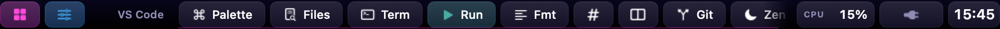

**It knows what app you're in.** The middle of the bar swaps to buttons made for the app in front: VS Code, Cursor, Xcode, Terminal, iTerm, Warp, browsers, Spotify, Finder, Slack, Figma, Zoom and more. Final Cut and Logic get the stock bar back, because their own Touch Bar support is good. Widgets live on the right.

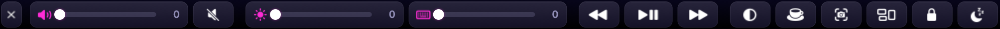

**Control bar** (<kbd>⌃⌥⌘C</kbd>): volume, display brightness, keyboard backlight, media keys, dark mode, keep-awake, screenshot, Mission Control, lock and display sleep.


**Launcher** (<kbd>⌃⌥⌘Space</kbd>): every mode, one swipe away.

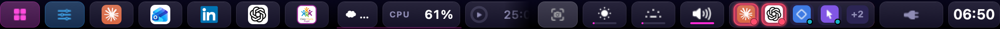

**It watches your coding agents.** Claude Code and Codex in a terminal, Cursor, the Claude and ChatGPT apps, Devin, Grok,
and web agents in Chrome, Safari, Arc, Brave or Edge (Claude Code on the web, Codex, Devin, Jules, Copilot, Lovable, Bolt…).
Each one gets a chip on the right of the home bar. The moment one stops and waits for you (a permission prompt, a question,
a finished turn) its chip pulses red and a toast says who and why. Tap the chip and that terminal tab, app window or browser
tab comes to the front, Spaces and all. Tap **Agents** in the launcher for the full list with what each one is doing.

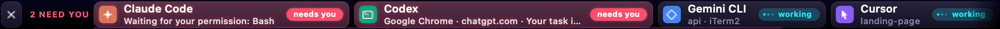

<details>
<summary>How it knows, and how to make it exact</summary>

Nothing to install or configure. The signals, strongest first:

1. **Session journals.** Claude Code and Codex write every turn to disk as they go (`~/.claude/projects/…/*.jsonl`,
   `~/.codex/sessions/…/rollout-*.jsonl`). widefive matches the file to the process by folder and start time and reads
   the last line: a finished reply means *waiting for your next prompt*; a tool call with no result and nothing running
   means *waiting for your permission* (and names the tool); a Codex approval event means exactly that.
2. **Notification banners.** Anything that posts a macOS notification when it needs you — Chrome or Safari for web agents
   (Claude Code on the web, Codex, Devin…), Cursor, the Claude and ChatGPT apps, iTerm2 and Terminal bells from CLIs —
   is read off the banner through the Accessibility permission widefive already has, and matched to the agent by app,
   site and project name. Nothing is stored; only banners on screen are read.
3. **Dock badges.** Apps that badge their Dock icon when a reply is ready show as waiting.
4. **Process activity.** A terminal agent whose whole process tree has burned no CPU for `idleSeconds` (6 s) is sitting at a
   prompt. Spinners keep ticking while an agent thinks or runs tools, so this catches agents without a journal too.
5. **Tab titles.** Browser tabs count as waiting when their title matches `attentionTitles` (`(1) …`, "needs your approval", …).
6. **Hooks (optional).** For a belt-and-braces exact signal, Menu → **Coding Agents → Install … Hooks** registers a 20-line
   shell script with Claude Code (`~/.claude/settings.json`), Codex (`notify` in `~/.codex/config.toml`) and Cursor
   (`~/.cursor/hooks.json`). Nothing else in those files is touched; **Remove … Hooks** puts them back.

Terminal tabs are found by tty in Terminal.app and iTerm2 (Warp, Ghostty, kitty, VS Code, Cursor get their window raised instead).
Browser tabs are read and selected over AppleScript, so macOS asks once per browser for Automation permission. Firefox can't be scripted.
Everything is tuned in `config.json`:

```jsonc
"agents": {
  "enabled": true, "toast": true, "sound": false,
  "idleSeconds": 6, "scanBrowsers": true,
  "processes": { "myagent": "My Agent" },                     // extra CLIs, by executable or script name
  "apps": { "com.example.agent": "Example" },                 // extra desktop apps, by bundle id
  "sites": { "app.example.com/agents": "Example" },           // extra web agents, by URL substring
  "attentionTitles": []                                       // regexes; empty = the built-in list
}
```

Put the chips anywhere with `{ "type": "widget", "name": "agents" }`. If something isn't showing up, run
`widefive --agents 30` (or `/Applications/widefive.app/Contents/MacOS/widefive --agents 30`): it prints every agent process,
journal, tab, badge and banner it can see, then watches for 30 seconds and reports what fires.

</details>

**Gestures:** slide two fingers for volume and three for brightness. A two-finger tap plays or pauses, and swiping in from the left edge opens the launcher.

## Themes


Neon, Graphite Pro, Midnight, Sunset, Nord, Dracula, Paper, Matcha, Synthwave and Mono OLED. Switch from the menu bar, or open the Themes mode and tap through them live.

## Toys and tools

| | |
|:--|:--|
| 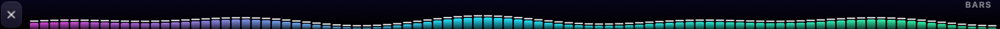<br>**Visualizer.** Your mic as a spectrum across the whole strip. | <br>**Ambient.** Nyan, matrix rain, starfield, game of life, fire, aurora. |
| 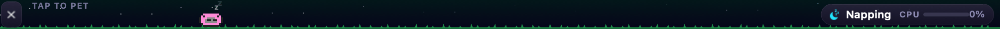<br>**Pixel cat.** Runs when your CPU is busy, naps when it's idle, purrs when you tap it. | 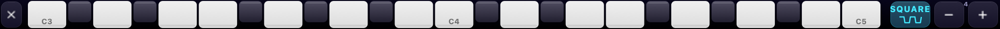<br>**Piano.** Two octaves, multi-touch, four waveforms. |
| <br>**Timer.** A stopwatch with laps, plus quick countdowns. | 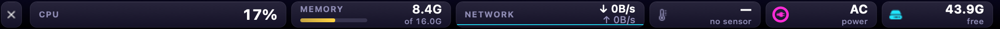<br>**Stats.** CPU, RAM, network, temperature, fan, battery and disk. |

Also: a calculator, an emoji bar that types for you, clipboard history, a strip of running apps and the coding-agent list.

## Hotkeys

| Keys | |
| --- | --- |
| <kbd>⌃⌥⌘Space</kbd> | launcher |
| <kbd>⌃⌥⌘H</kbd> | home |
| <kbd>⌃⌥⌘G</kbd> | Tiny Plumber |
| <kbd>⌃⌥⌘C</kbd> | control bar |
| <kbd>⌃⌥⌘K</kbd> | lock or unlock the keyboard to the current game |
| <kbd>⌃⌥⌘T</kbd> | re-show the bar if macOS takes it back |
| <kbd>⌃⌥⌘P</kbd> | preview window |
| <kbd>⌃⌥⌘M</kbd> | open the menu, even with the menu-bar icon hidden |

## Make your own buttons

Everything lives in `~/.widefive/config.json` (created on first launch, hot-reloaded on save).
Print the full default with `widefive --print-default-config`.

```jsonc
{
  "theme": "neon",                 // neon graphite midnight sunset nord dracula paper matcha synthwave oled
  "hideControlStrip": true,
  "startMode": "home",
  "apps": [
    {
      "name": "VS Code",
      "bundleIds": ["com.microsoft.VSCode"],
      "items": [
        { "kind": "button", "title": "Palette", "icon": "command", "action": { "keys": "cmd+shift+p" } },
        { "kind": "button", "title": "Test", "icon": "checkmark.seal",
          "action": { "shell": "cd ~/code/app && npm test 2>&1 | tail -1", "showOutput": true } },
        { "kind": "button", "title": "Deploy", "color": "#ff2d95",
          "action": { "applescript": "display notification \"shipping\"" },
          "longPress": { "url": "https://vercel.com/dashboard" } },
        { "kind": "widget", "name": "cpu" }
      ]
    },
    { "name": "Final Cut", "bundleIds": ["com.apple.FinalCut"], "items": [], "passthrough": true }
  ]
}
```

Action fields: `keys`, `shell`, `applescript`, `url`, `open` (app name/bundle id/path), `mode`,
`media` (`playpause|next|previous|volup|voldown|mute|brightup|brightdown`), `type` (+`submit`),
`showOutput`. Item kinds: `button`, `widget`, `slider` (`volume`/`brightness`), `spacer`, `separator`.
`passthrough: true` hands the stock Touch Bar back while that app is frontmost; `mode` opens a mode.

Built-in layouts: VS Code/Cursor/Windsurf, Xcode, Terminal/iTerm/Warp/Ghostty, browsers, Spotify/Music,
Finder, Slack/Discord, Figma, Zoom/Teams, Final Cut/Logic (passthrough).

Widgets: `clock`, `date`, `cpu`, `ram`, `battery`, `network`, `temp`, `fan`, `disk`, `uptime`,
`weather`, `app`, `nowplaying`, `pomodoro`, `agents`.

## Build a new mode

Modes are small classes implementing `StripMode` (see `Sources/WideFiveKit/Core/Mode.swift`).
You get a `Canvas` the size of the strip (1004 or 1085 × 30 points) every frame plus touch and key callbacks:

```swift
public final class HelloMode: StripMode {
    public let id = "hello", title = "Hello", icon = "hand.wave"
    public var isAnimated: Bool { true }
    var t = 0.0
    public func update(dt: Double) { t += dt }
    public func draw(_ c: Canvas) {
        c.fill(c.bounds, .hsb(CGFloat(t * 0.1), 0.8, 0.4))
        c.text("hello touch bar", x: c.width / 2, size: 12, align: .center)
    }
    public func touchBegan(_ t: StripTouch) { /* t.x is 0…width */ }
}
```

Register it in `ModeRegistry.standard()` and it shows up in the launcher.

## Fit and feel

widefive reads your Mac's model and sizes the strip to match: 1004 points on Macs with a physical Esc key (2020 13", 2019 16"), and 1085 on 2016–2018 models. The menu shows what it detected. If it's still off, use **Strip Width → Narrower / Wider**. There's no Dock icon, and **Hide Menu-Bar Icon** removes the last trace; <kbd>⌃⌥⌘M</kbd> brings the menu back.

## Development

```bash
swift test                                                    # includes an end-to-end test that fakes a `claude` process + journal
swift run widefive --agents 30                                # what the coding-agent monitor sees on this Mac, live for 30 s
swift run widefive --snapshot race:demo shot.png 3 1004       # render any mode to a PNG
swift run widefive --frames plumber:demo frames/ 4 1004 25 1  # PNG sequence → GIF/MP4 (how the media here was made)
```

## Releasing

Everything is in `Scripts/` and runs on any Mac; the GitHub Actions workflow just calls it.

**One-time setup** (the update signing key):

```bash
Scripts/setup-sparkle-keys.sh   # makes an EdDSA key in your login keychain,
                                # writes Resources/sparkle-public-key.txt, uploads SPARKLE_PRIVATE_KEY via gh
git add Resources/sparkle-public-key.txt && git commit -m "Add Sparkle public key" && git push
```

The private key never goes in the repo. Back it up (`.build/artifacts/sparkle/Sparkle/bin/generate_keys -x key.txt`
→ password manager, then delete the file): if it's lost, installed copies can't verify updates anymore.
If `gh` isn't logged in, add the secret by hand under Settings → Secrets and variables → Actions.

**Each release:**

```bash
echo 0.2.0 > VERSION && git commit -am "v0.2.0"
git tag v0.2.0 && git push origin main v0.2.0   # .github/workflows/release.yml builds + publishes
# or, without Actions:
Scripts/release.sh v0.2.0             # dry run → dist/ (app zip, dmg, appcast.xml, widefive.rb, SHA256SUMS.txt)
Scripts/release.sh v0.2.0 --publish   # same, then creates the GitHub release with gh
```

| Script | Does |
| --- | --- |
| `build-app.sh [--native]` | universal release build → `build/widefive.app` (Info.plist, icon, Sparkle.framework, signed) |
| `make-dmg.sh` | `dist/widefive-x.y.z.dmg` (drag-to-Applications window) + `.zip` |
| `appcast.sh vX.Y.Z` | `dist/appcast.xml`, previous releases kept, EdDSA-signed |
| `notarize.sh <path>` | notarize + staple, skipped without Apple credentials |
| `make-icon.sh` | regenerate `Resources/AppIcon.icns` from `Scripts/art.swift` |

Version = the tag (or `VERSION`); build number = commit count, so it always increases.

**Signing.** By default builds are ad-hoc signed (`codesign -s -`), which needs no Apple account. To ship
signed + notarized builds later, add these Actions secrets: `APPLE_DEVELOPER_ID_CERT` (base64 .p12 of a
Developer ID Application certificate), `APPLE_DEVELOPER_ID_CERT_PASSWORD`, `APPLE_ID`, `APPLE_TEAM_ID`,
`APPLE_APP_PASSWORD` (app-specific password). Locally, a Developer ID in your keychain is picked up
automatically (override with `CODESIGN_IDENTITY`), plus the three `APPLE_*` env vars for notarization.

**Homebrew tap.** Create the repo `rayhankhilji/homebrew-tap` once, then after each release copy
`dist/widefive.rb` (the [Casks/widefive.rb](Casks/widefive.rb) template with the version + sha256 filled in)
to `Casks/widefive.rb` in the tap and push. Users install with `brew install --cask rayhankhilji/tap/widefive`.

## Caveats

- Private APIs: Apple can change them in any macOS update. If the strip stops showing, hit ⌃⌥⌘T or
  open an issue with your macOS version.
- Temperature/fan readings use the Intel SMC and show "—" on Apple Silicon.
- Brightness uses the private DisplayServices framework; keyboard backlight uses private CoreBrightness
  (falls back to the F5/F6 illumination keys).
- The agent strip's "waiting" detection is exact for Claude Code and Codex (their session journals) and for anything that
  posts a notification; the rest is CPU/badge/title heuristics. Keep notifications allowed for your browser and agent apps
  (Focus modes hide banners), and add patterns under `agents.attentionTitles` for sites with their own title convention.
- The Intel MacBook Pro keyboard backlight is a single zone: one level for every key. Per-key lighting
  isn't possible in software on that hardware.
